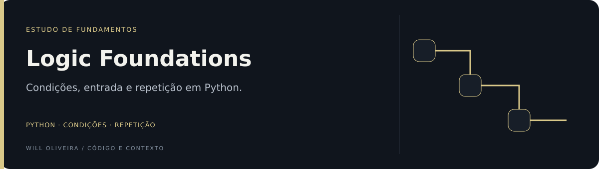
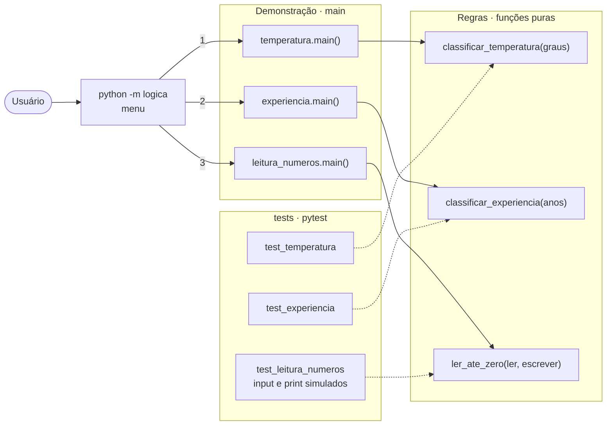
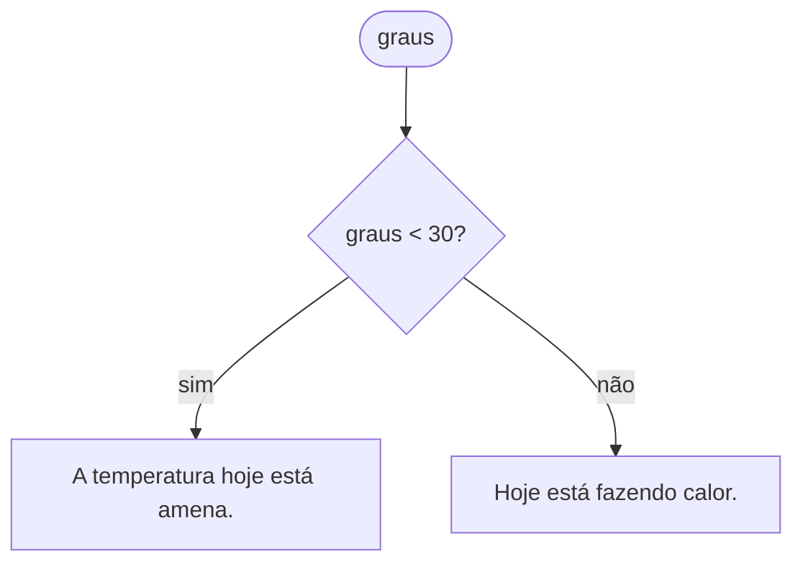
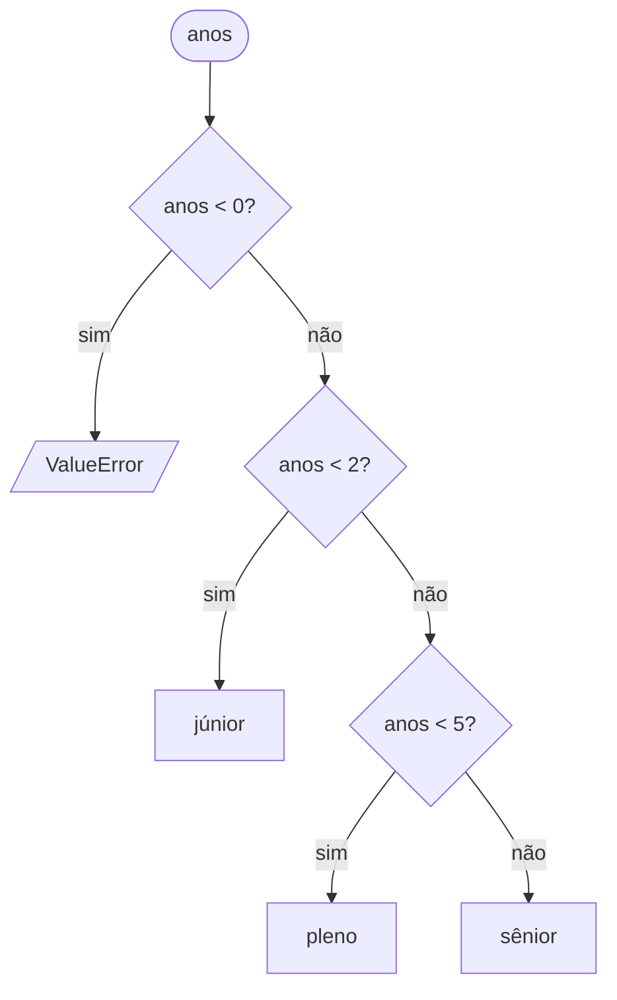
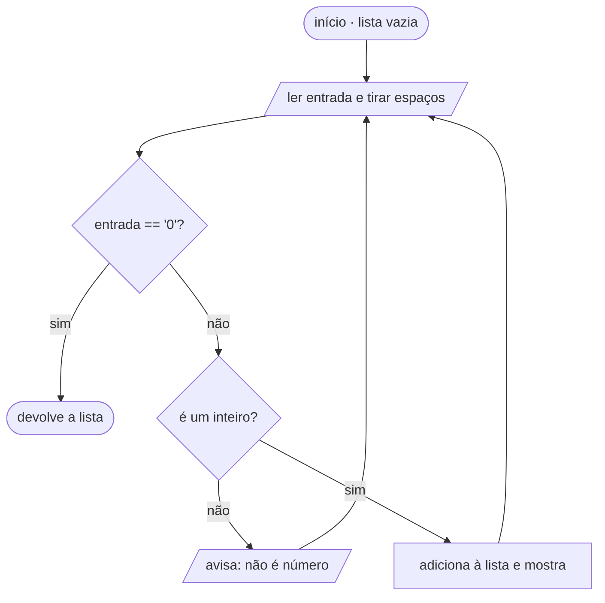

<p align="center">
  
</p>

# Lógica de programação · caso de estudo em Python

Três exercícios introdutórios (condição, faixas e repetição) revisitados com o olhar de hoje: funções puras, entrada validada, testes automatizados e lint.

**Python 3.10+ · pytest · ruff**

## Exercícios

| Módulo | Conceito | Função principal |
| --- | --- | --- |
| [`logica/temperatura.py`](logica/temperatura.py) | `if/else` | `classificar_temperatura(graus)` |
| [`logica/experiencia.py`](logica/experiencia.py) | `if/elif/else` com faixas | `classificar_experiencia(anos)` |
| [`logica/leitura_numeros.py`](logica/leitura_numeros.py) | `while` com condição de parada | `ler_ate_zero(ler, escrever)` |

## Arquitetura

O menu só escolhe o exercício. Cada módulo separa a regra (função pura, testada) da demonstração (`main`, que imprime).



## Como cada exercício decide

**1. Temperatura (`if/else`)**



**2. Nível de experiência (`if/elif/else`).** As faixas são contínuas, então todo valor tem destino.



**3. Leitura até zero (`while`)**



## O que mudou na revisão

**1. Um bug de limite.** A versão original classificava experiência com `< 2` e `> 2 and < 5`. Com exatamente 2 anos nenhuma das duas condições era verdadeira, e o valor caía no `else` como "sênior". Agora as faixas são contínuas, `[0, 2)`, `[2, 5)` e `[5, ∞)`, e o caso de 2 anos tem um teste próprio.

**2. Lógica separada de entrada e saída.** Os scripts misturavam cálculo e `print`. Agora cada exercício expõe uma função que recebe valores e devolve resultado, o que permite testá-la sem terminal. O `main()` de cada módulo só demonstra a função.

**3. Entrada validada.** O exercício 3 aceitava qualquer texto. Agora ele converte para inteiro, avisa quando a entrada não é número, ignora espaços em volta e devolve a lista lida. `input` e `print` são injetados como parâmetros, então os testes simulam o usuário.

**4. Convenções.** Nomes em `snake_case`, constantes para os limites (`LIMITE_CALOR`, `LIMITE_PLENO`, `LIMITE_SENIOR`), type hints, docstrings e `ruff` para estilo e imports.

| Antes | Depois |
| --- | --- |
| 3 scripts soltos na raiz | pacote `logica/` + menu `python -m logica` |
| Nenhum teste | 15 casos com `pytest`, incluindo limites |
| `tempoExperiencia = 2` → "sênior" | 2 anos → "pleno" |
| Qualquer texto aceito no loop | Só inteiros; entrada inválida gera aviso |

## Executar

```bash
python -m venv .venv
.venv\Scripts\activate        # Windows
source .venv/bin/activate     # Linux/macOS
pip install -r requirements-dev.txt
```

Menu interativo com os três exercícios:

```bash
python -m logica
```

Um exercício direto:

```bash
python -m logica.experiencia
```

Testes e lint:

```bash
pytest
ruff check .
```

## Para continuar praticando

- Ler a temperatura do usuário no exercício 1, validando entrada como no exercício 3.
- Fazer o exercício 3 mostrar soma, média e maior valor ao encerrar.
- Escrever o teste antes da mudança e só depois implementar.

---

Mantido por **Will Oliveira** · [Perfil](https://github.com/Will-Ifes) · [LinkedIn](https://www.linkedin.com/in/wildemberg-de-jesus-oliveira/)
